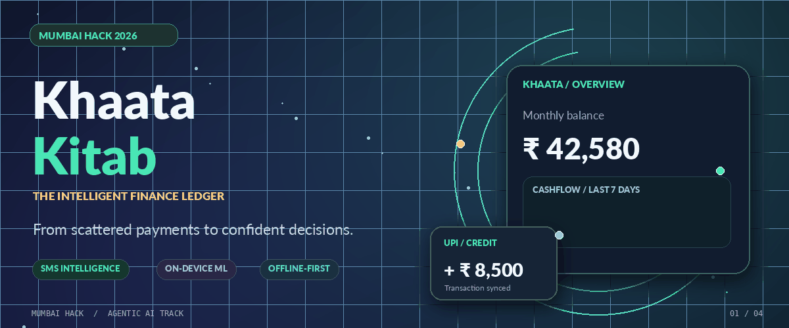
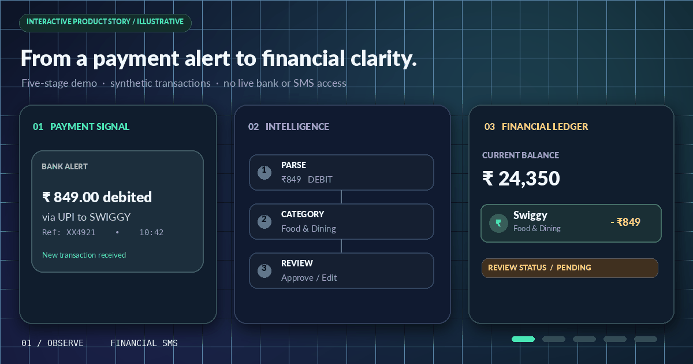
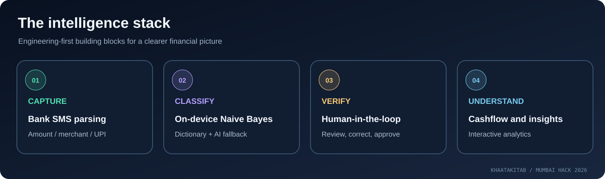
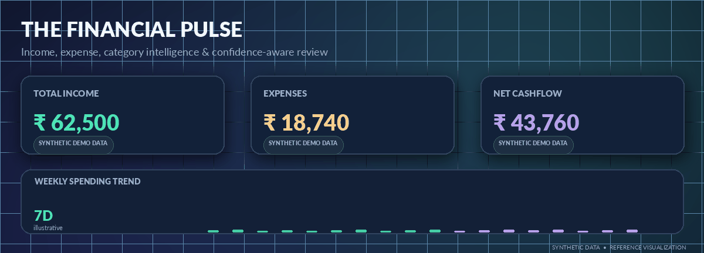
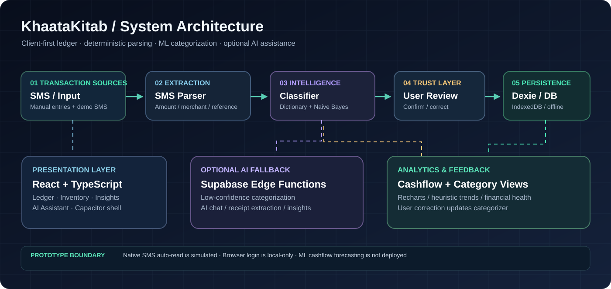
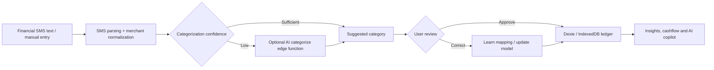

<div align="center">



<br/>

[](https://github.com/Vedanto28/khaata-Kitab-)
[](#-the-idea)
[](#-technology)
[](#-implementation-status)

### An intelligent, offline-first ledger for everyday Indian finance.

**Observe the signal. Understand the transaction. Verify the truth. Act on the insight.**

[**Launch Web Demo ↗**](https://khaata-kitab.lovable.app) &nbsp;·&nbsp; [**Watch the Product Story ▶**](docs/assets/product-demo.mp4) &nbsp;·&nbsp; [**Architecture ↓**](#-system-architecture) &nbsp;·&nbsp; [**Run Locally ↓**](#-run-locally)

<sub>Built for Mumbai Hack 2026 · Agentic AI track · Demo content below is illustrative, not recorded from a bank account.</sub>

</div>

---

## ✦ Why KhaataKitab exists

Transactions are everywhere: banking alerts, UPI confirmations, cash entries, shopping receipts, and fragmented payment histories. Yet the actual financial picture still needs manual reconstruction.

**KhaataKitab turns those signals into a structured, reviewable ledger.** It combines local parsing, merchant normalization, on-device statistical classification, feedback-driven categorization, and a financial insights layer. When confidence is low, an optional edge-function AI fallback can assist—without taking the final decision away from the user.

| Traditional record keeping | KhaataKitab's approach |
|:--|:--|
| Type every transaction by hand | Parse financial SMS text and add/manual-review entries |
| Rules alone struggle with messy merchants | Combine learned mappings, merchant dictionary, Naive Bayes and optional AI fallback |
| Uncertain data looks certain | Surface review and verification states |
| Ledger is a static spreadsheet | Show income, spending, categories, merchant patterns and financial trends |
| Every screen depends on the cloud | Dexie/IndexedDB local-first transaction storage |

---

## 🎬 The product story — in motion

<div align="center">


<sub>Illustrative UI animation using **synthetic data**. This is not a screen recording and does not imply production bank/SMS integration.</sub>

<br/><br/>

[**▶ Watch the short MP4 demo**](docs/assets/product-demo.mp4) &nbsp;·&nbsp; [**🧩 Open the interactive browser demo**](docs/demo/index.html)

</div>

> **Interactive demo:** Download `docs/demo/index.html` and open it in a browser. The self-contained demo lets you edit a sample SMS, run a simulated extraction, review the result, and add it to a sample ledger. GitHub README pages don't execute arbitrary JavaScript, so the animation above is the inline experience.

---

## ⚡ What the product does



<details open><summary><b>01 · SMS-to-ledger ingestion</b></summary>

A parser extracts **amount, payment direction, transaction method, merchant, reference ID, and masked account digits** from financial message text. Parsed records can enter review before persisting to the ledger. The app also supports manually recorded transactions.

**Current integration status:** financial SMS parsing and simulated message ingestion work in the codebase; actual automatic native Android SMS reading/listening is **not yet implemented**.

</details>

<details><summary><b>02 · Layered merchant intelligence</b></summary>

The categorization path considers user-learned mappings, merchant normalization/dictionary signals, and an on-device **multinomial Naive Bayes classifier**. Low-confidence cases can call a Supabase Edge Function for LLM assistance. User corrections update the model's learned mapping/word counts.

**Why it matters:** the expensive external path is optional, and users remain able to inspect or correct the result.

</details>

<details><summary><b>03 · Verified, not blindly automated</b></summary>

Low-confidence transactions can be flagged for review. The ledger uses confidence/verification metadata and cross-checks manually recorded payments against SMS-like data for possible matches, rather than generating duplicate entries indiscriminately.

</details>

<details><summary><b>04 · Cashflow intelligence</b></summary>

Financial views include monthly income and expenses, merchant/category breakdowns, an estimated financial health signal, spending alerts, and cashflow trends. The forward cashflow estimate currently uses a **rule-based rolling heuristic**, not a trained forecasting model.

</details>

<details><summary><b>05 · AI copilot, receipts, and inventory</b></summary>

The repository contains a financial AI assistant with streaming responses, receipt upload/capture flows with an AI Edge Function, and inventory management pages. **The local OCR fallback is currently mocked**; real extraction depends on the configured AI receipt function. Inventory-to-ledger automatic synchronization remains planned.

</details>

---

## 📊 FinTech observability, without the noise

<div align="center">

<sub>Visual demonstration only. Figures are synthetic; KhaataKitab computes its real charts from the current local transaction ledger.</sub>
</div>

The application uses reactive local queries to update expense/category visualizations and displays spending through **Recharts** dashboards.

---

## 🏗 System architecture

<div align="center"></div>



### Actual implementation boundaries

| Layer | Implemented with | Code to inspect |
|:--|:--|:--|
| Client | React, TypeScript, Vite, Tailwind, shadcn/ui | `src/app/App.tsx`, `src/pages/` |
| Transaction storage | Dexie → browser IndexedDB | `src/database/db.ts` |
| SMS parsing | Financial-text rules and cleanup | `src/services/sms/smsParser.ts` |
| Classification | Naive Bayes + merchant intelligence | `src/lib/ml/classifier.ts`, `src/lib/ml/sms-ml-service.ts` |
| AI escalation | Supabase Edge Functions | `supabase/functions/ai-categorize/`, `src/services/ai/aiClient.ts` |
| Receipt processing | AI receipt function + fallback | `src/components/receipts/ScanReceiptDialog.tsx` |
| Financial dashboard | Reactive queries, Recharts, heuristics | `src/pages/Insights.tsx`, `src/services/ai/aiInsights.ts` |
| Android shell | Capacitor | `android/`, `capacitor.config.ts` |

### Intelligence pipeline in one glance

```text
SMS-like financial signal
      |
      v
Parse -> normalize -> extract merchant + amount + direction
      |
      v
Learned mapping / merchant dictionary / Naive Bayes
      |                                | high confidence            \ low confidence
      v                            v
Suggested category        AI category fallback (if configured)
      |____________________________|
                     |
                     v
              User review
                     |
                     v
           Dexie local ledger
                     |
        +------------+------------+
        v            v            v
     Insights     Trends       AI assistant
```

---

## 🧠 What is genuinely AI here?

**Statistical ML:** The app includes an on-device Naive Bayes classifier with online updates from corrected transactions; it is not simply a static merchant keyword table.

**LLM-assisted operations:** Supabase Edge Functions are wired for categorization, chat, receipt extraction, and insights, subject to function deployment and API availability.

**Human-in-the-loop:** Ambiguous classifications can be reviewed, corrected, and used for further categorization updates.

**Not yet complete:** Native Android SMS listener, cloud synchronization, and true ML-based financial forecasting are not production-ready. This README intentionally separates implemented work from roadmap ideas.

---

## 🛡 Design principles

| Principle | Decision |
|:--|:--|
| Local-first | Store the primary transaction ledger in IndexedDB through Dexie |
| Explain uncertainty | Expose confidence, verification, and review states |
| Minimize duplicate entries | Compare incoming SMS-derived entries with existing ledger records |
| Keep AI optional | Escalate low-confidence classifications to an Edge Function when available |
| Privacy-conscious UI | Mask account fragments when possible and prefer local parsing |
| User control | Confirmation and correction before treating predictions as final |

> **Prototype security note:** The current browser auth provider uses a `localStorage` flag rather than verified server-side authentication. Do **not** represent this as production-grade account security. Transaction data is browser-local; additional access controls are needed before a production financial-data service.

---

## 🛠 Technology

<div align="center">

</div>

| Area | Technology |
|:--|:--|
| Frontend | React · TypeScript · Vite · Tailwind CSS · shadcn/ui · Framer Motion |
| Local persistence | Dexie · IndexedDB |
| Analytics | Recharts |
| On-device intelligence | Naive Bayes classifier · Merchant dictionary · Feedback-based learning |
| Cloud AI | Supabase Edge Functions · Configured AI gateway |
| Mobile wrapper | Capacitor · Android project |

---

## 🚀 Run locally

```bash
# Node.js 20+ recommended
git clone https://github.com/Vedanto28/khaata-Kitab-.git
cd khaata-Kitab-
npm install
```

Create a local `.env` using the **public configuration identifiers for your own Supabase project** (never put service-role/API secrets into `VITE_` variables):

```dotenv
VITE_SUPABASE_URL=https://YOUR_PROJECT.supabase.co
VITE_SUPABASE_PUBLISHABLE_KEY=YOUR_PUBLIC_PUBLISHABLE_KEY
```

```bash
npm run dev
```

Open the local URL printed by Vite. The interface and local Dexie ledger can run in the browser; calling AI Edge Functions requires working cloud configuration.

For the Capacitor Android wrapper:

```bash
npx cap sync android
npx cap open android
```

**Note:** An Android shell is present, but native SMS reading currently uses simulated messages in the checked implementation.

---

## 🗂 Repository map

```text
khaata-Kitab-/
├── src/
│   ├── app/                    # Routing + application shell
│   ├── pages/                  # Ledger, Insights, Inventory, AI Assistant
│   ├── components/             # Finance widgets, review, receipt input
│   ├── database/               # Dexie transaction store
│   ├── lib/ml/                 # SMS classification + online learning
│   ├── services/sms/           # Parser and Android integration boundary
│   └── services/ai/            # Cloud AI functions, insights
├── supabase/functions/         # ai-categorize, ai-chat, ai-receipt, ai-insights
├── android/                    # Capacitor Android project
├── docs/
│   ├── assets/                 # README motion graphics and diagrams
│   └── demo/                   # Standalone interactive product illustration
└── README.md
```

---

## 🧭 What's implemented vs what's next

| Capability | Current state |
|:--|:--|
| Manual ledger and transactions | ✅ Code present |
| Client-side SMS parsing and sample ingestion | ✅ Code present |
| Merchant normalization and ML categorization | ✅ Code present |
| On-device feedback / correction loop | ✅ Code present |
| Offline-first IndexedDB storage | ✅ Code present |
| Interactive insights and chart views | ✅ Code present |
| AI chat, categorize, receipt edge function integrations | ⚙️ Wired; depends on deployment |
| Native Android inbox listener | 🚧 Simulated / pending native plugin |
| Receipt fallback OCR | 🚧 Mock fallback |
| Real multi-device cloud ledger sync | 🗓 Planned |
| Production-grade server authentication / RLS data isolation | 🗓 Planned |
| Inventory-to-ledger event syncing | 🗓 Planned |

---

## 🔍 Explore the demo

<div align="center">

**[Open the web prototype →](https://khaata-kitab.lovable.app)** · **[Download the demo video →](docs/assets/product-demo.mp4)** · **[Run the interactive local simulation →](docs/demo/index.html)**

<sub>The README animations and included interactive demo use illustrative values, not live transactions or recorded user activity. GitHub does not run arbitrary interactive HTML inside README files.</sub>

</div>

---

<div align="center">

**KhaataKitab** — *finance data should be understood, not merely collected.*

<sub>Mumbai Hack 2026 · Agentic AI Track · Built to learn, iterate, and ship responsibly</sub>

</div>
